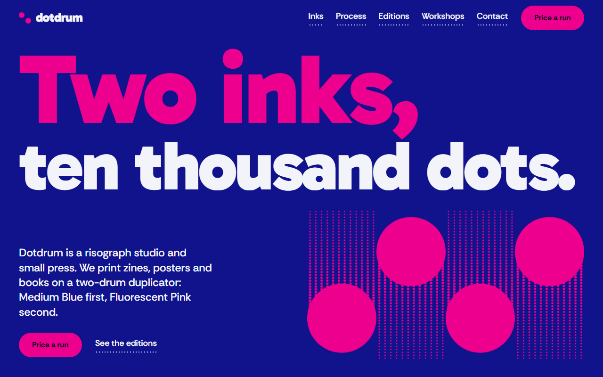

# Free HTML print studio website template with GSAP scroll animations — Dotdrum

**One-page website for a print studio or small press, with a price calculator, shop and workshop dates: a free HTML template in one file, with GSAP scroll animations, no build step, MIT license. Made by [8B](https://8b.com/), the AI website builder.**

[](LICENSE)  

**[Live demo](https://8bsite.github.io/print-studio-website-template/)** · **[Use this template](https://github.com/new?template_name=print-studio-website-template&template_owner=8bsite)** · **[Download ZIP](https://github.com/8bsite/print-studio-website-template/archive/refs/heads/main.zip)** · **[Template page on 8b.com](https://8b.com/templates/dotdrum/)**

<a href="https://8bsite.github.io/print-studio-website-template/"></a> <a href="https://8bsite.github.io/print-studio-website-template/"></a>

<p align="center"><a href="https://8bsite.github.io/print-studio-website-template/"></a><br><sub>Scroll animation</sub></p>

A one-page site for a two-ink risograph studio that prints zines, posters and books, sells its own editions and runs workshops. Two flat inks, ultramarine and fluorescent pink, and halftone dots drawn in CSS; as you scroll, four drums print the page band by band, ink plates slide into register and a drum inks the workshop dates one by one.

Good for: risograph, screen-print or letterpress studio; print shop or copy shop with online quotes; small press or zine publisher with a few editions for sale; craft studio that sells work and runs workshops; any small studio with a two-colour graphic identity.

## Use it with an AI coding agent

Download the files into your project (in Windows PowerShell type `curl.exe`):

```bash
curl -LO https://raw.githubusercontent.com/8bsite/print-studio-website-template/main/index.html
curl -LO https://raw.githubusercontent.com/8bsite/print-studio-website-template/main/AGENTS.md
curl -LO https://raw.githubusercontent.com/8bsite/print-studio-website-template/main/LICENSE
curl -LO https://raw.githubusercontent.com/8bsite/print-studio-website-template/main/CREDITS.md
```

Then give your agent this prompt:

```text
Read AGENTS.md, then edit index.html. Use this template as the base for a site for <your studio or shop: what you make or print, where you are, your prices, products, workshops or events, how people order or book>. Keep the layout, the motion and the single-file format; replace the brand name, copy, photos, prices and rates, dates, client list, links and contacts, and recolour it through the CSS variables if needed.
```

Give the agent the downloaded file, not a link: from a link it would rebuild a different page. No agent? Click **[Use this template](https://github.com/new?template_name=print-studio-website-template&template_owner=8bsite)**, edit `index.html` and turn on **Settings → Pages**.

## What's on the page

- **Navigation** — top bar: wordmark, section links, Price a run button; phone menu overlay
- **Two inks, ten thousand dots.** — two-screen opening: big two-line headline and four drums with halftone trails, then a pink panel with the studio statement, a photo and three facts
- **Two inks. Sixteen colours.** — colour chart: two ink plates overprint into a 4×4 grid of tints (demo: blue and pink)
- **One sheet, two passes.** — how it works: five numbered steps on a horizontal track beside a sheet that gets printed step by step
- **A small room with a loud machine.** — about the studio: paragraph, list of four machines, three photos at alternating heights
- **From our own drum.** — shop: eight products in four staggered lanes, each with photo, title, format, price and Order link (demo: zines, prints and books)
- **Learn the drum.** — event list: five dated sessions with price, places left and a Book link, beside a lane where a drum inks each date
- **Price a run.** — price calculator: job options on the left, a live job ticket with total, unit price and turnaround, and a Send this ticket email button
- **Lately on the drum.** — list of recent clients and jobs set in large type (demo: a press log)
- **Before you send a file.** — questions and answers (native &lt;details&gt;)
- **Bring a file. Leave with a stack.** — address, opening hours, email, phone and a contact form (placeholders), four drums across the foot
- **Footer** — width-filling dotdrum wordmark, links, address, socials, copyright and the Design: 8B credit

## Design

Palette:      
Fonts: Gabarito, Rethink Sans (Google Fonts). Change both through the CSS variables in the `:root` block at the top of `<head>`. A big display line with `style="--len:N"` fills its width: set N to its new number of characters.

- The drums, lanes, halftone trails, the colour chart and the sample sheet are HTML and CSS (gradients and masks), not images: recolour them through the tokens.
- The quote calculator's rates are data attributes on the form; change them there, and the currency in section-script:quote.

## Before you publish

- Replace everything marked `data-8b-placeholder` (social preview image, favicon, email, form, phone, social) and the invented demo facts: prices, dates, address. [AGENTS.md](AGENTS.md) lists them.
- The form sends nothing yet: connect it to Formspree or Netlify Forms, or remove it.

## Tech

GSAP 3.13.0, ScrollTrigger, Lenis 1.3.27 from jsDelivr, 99 KB, no build step. Chrome and Edge 111+, Safari 16.2+, Firefox 121+ (it uses color-mix(), container query units, :has(), cascade layers, small/dynamic viewport units). With "reduce motion" on, the page is complete and still.

## License

MIT, see [LICENSE](LICENSE). Photos, fonts and libraries keep their own licences: [CREDITS.md](CREDITS.md). More free templates: [8b.com/templates](https://8b.com/templates/) · [github.com/8bsite](https://github.com/8bsite).
